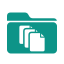
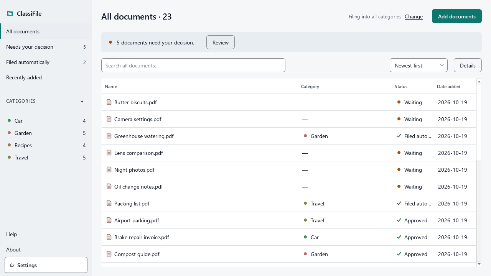
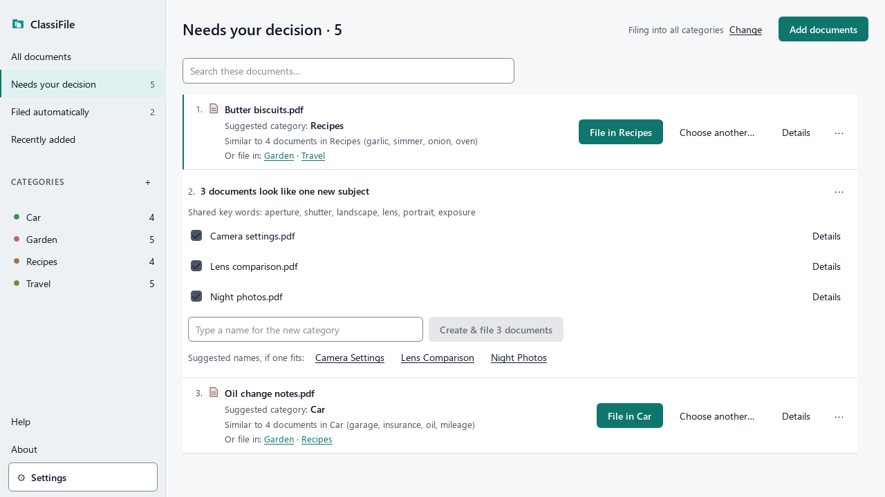
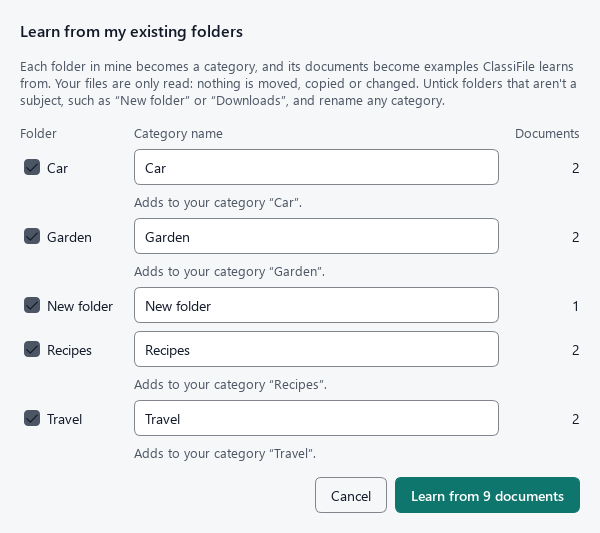
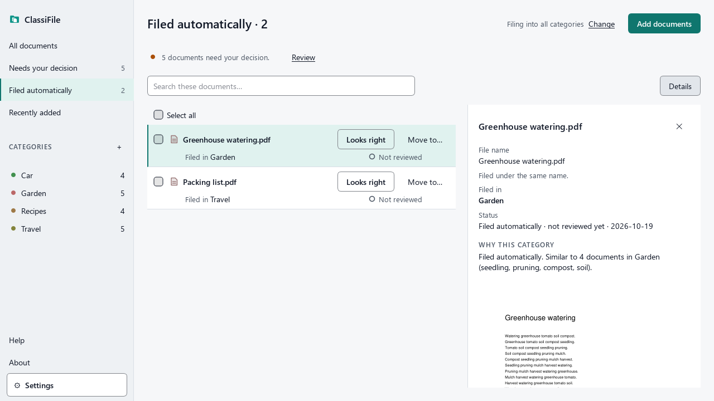

<p align="center"></p>

# ClassiFile

ClassiFile sorts your documents into categories by what they say. It files a copy of each document in the right
folder when it is sure, asks you when it isn't, and learns from your answers. Everything happens on your computer:
your original files are never changed, and nothing is sent over the internet.

ClassiFile is part of the ClariFile suite. Its companion, SummarEase, will summarize documents; each app works on its
own.

> **Status:** v1 release candidate (1.0.0-rc.9, for a small pilot), for Windows. The screenshots show a made-up library.



## What it does

- **Reads PDF, PPTX, DOCX and ODT files**, including text inside pictures (with OCR).
- **Files clear matches by itself.** When one of your categories is clearly the best fit and already holds 3
  documents you confirmed, the document is filed there without a question.
- **Asks when it isn't sure.** Those documents wait in *Needs your decision*, each with the categories that fit best
  and why.
- **Learns from you.** Every document you file, confirm or move teaches it. It can also learn from folders you have
  already organized.
- **Never touches your originals.** It works on copies, in an output folder you choose.



## Install

1. Download `ClassiFile-<version>-setup.exe` from the
   [releases page](https://github.com/ClariFile/ClassiFile/releases) and run it. It installs for your Windows user
   only, without an administrator prompt. Reading text in pictures (OCR) is included.
2. **If Windows shows "Windows protected your PC"** (SmartScreen): click **More info**, then **Run anyway**. Windows
   shows this for programs that are new and not yet widely downloaded; ClassiFile is not signed with a paid
   certificate.

The internet is needed only to download. ClassiFile itself makes no connection. *Help → Check for updates* opens the
releases page in your browser, only when you click it.

**Uninstall:** Windows **Settings → Apps → Installed apps** → ClassiFile → **⋯ → Uninstall**. Your original files,
the organized copies in your output folder and ClassiFile's catalog (`%LOCALAPPDATA%\ClassiFile`) stay. Delete those
two folders yourself if you no longer want them.

**From source** (developers): install [Python 3.12](https://www.python.org/downloads/) and
[Tesseract OCR](https://github.com/UB-Mannheim/tesseract/wiki) (in `C:\Program Files\Tesseract-OCR`), then in the
ClassiFile folder:
```
py -3.12 -m venv .venv
.venv\Scripts\python -m pip install -r requirements.txt
.venv\Scripts\python -m classifile.app
```

## First steps

1. **The tour.** On the first start, four short steps explain how ClassiFile works. Then choose an output folder:
   ClassiFile puts its organized copies there.
2. **Start with what you have.** If you already keep documents in folders, choose *Learn from my existing folders*
   (in the tour, on the start page, or in Settings). Each folder becomes a category and its documents become
   examples. Untick folders that aren't a subject (like "Downloads") and rename any. Your files are only read:
   nothing is moved or copied.
3. **Add documents.** Drop files on the window or press *Add documents*.
4. **Answer the questions.** In *Needs your decision*, choose a category for each waiting document, or type a new
   one. Once a category holds 3 documents you confirmed, ClassiFile files clear matches into it by itself.
5. **Check what it filed.** *Filed automatically* lists what ClassiFile filed on its own, with the reason. Press
   *Looks right*, or *Move to…* if it is wrong.



## How learning works

ClassiFile compares the words of a new document with the documents already in each category. It files the
document only when one category is clearly ahead of the others; how clearly is a setting (Strict by default).

It learns only from what you decide: documents you file, confirm with *Looks right* or move, and the examples
from your folders. Documents it filed by itself never teach it until you confirm them. It updates after every 10
of your decisions and keeps the previous version if the new one would make more mistakes.

When at least three waiting documents share a subject none of your categories covers, ClassiFile can create a
folder for them and name it; you can rename it with one click, or switch this off in Settings. *Check these* lists
filed documents that read much more like another category; nothing is moved unless you choose to.



## Privacy

- ClassiFile works entirely offline. It makes no internet connection.
- Your original files are never changed, moved, renamed or deleted. Nothing is written into any document.
- What ClassiFile knows about your documents (their text, for matching) stays in its catalog on your computer
  (`%LOCALAPPDATA%\ClassiFile`). Removing a waiting document, or forgetting a learned folder, deletes what it stored.

## Known limitations

- **English only.** Documents in other languages are read but rarely matched well.
- **Tested on study and work documents.** Everyday documents (bills, receipts, IDs, letters) and phone photos
  have not been tested yet.
- **Pictures and scans:** JPG and PNG files can't be added yet. Inside PDFs and slides, OCR misses text in tables,
  boxes, and on dark or gradient backgrounds.
- **Category names are usually yours.** Subject names are rarely written in documents, so ClassiFile's suggested
  names often need typing over.
- **Small categories** (one or two documents) are rarely matched until they hold about five.
- **Windows only** for now.

## Roadmap: v1.1

- **Phone photos and scans** (JPG and PNG), after testing on real phone photos.
- **Household documents**: bills, receipts and letters, measured on a test set first.
- **Burmese**: the interface and Burmese documents.

## For developers

See `CLAUDE.md` for the commands (tests, evaluation, interface checks) and `DECISION_RECORD.md` for the design
decisions. The user guide is in `docs/guide/`.

## Licence and credits

ClassiFile is free software under the GNU Affero General Public License, version 3 (see `LICENSE`). It is built
with [PyMuPDF](https://pymupdf.readthedocs.io/) (AGPL-3.0), [Qt for Python](https://doc.qt.io/qtforpython/)
(PySide6, LGPL-3.0) and the [Tesseract OCR](https://github.com/tesseract-ocr/tesseract) engine (Apache 2.0).
